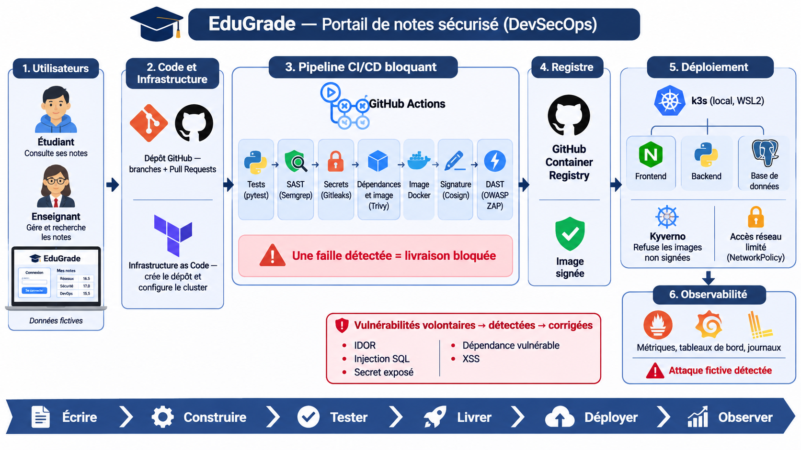

# EduGrade — Portail de notes sécurisé (DevSecOps)

EduGrade est un portail web de gestion de notes universitaires : l'administrateur
gère les comptes enseignants et étudiants, les enseignants gèrent les matières et
les évaluations, chaque étudiant consulte ses propres résultats. Le projet sert de support au module **DevSecOps
(ING-5-SSIR)** : l'application est **volontairement vulnérable**, puis chaque faille
est **détectée** par une chaîne d'outils automatisée et **corrigée**, preuves
avant/après à l'appui.

L'idée directrice : **tout est déclaré en code et toute la chaîne est
vérifiable**, de la configuration du dépôt GitHub jusqu'à l'image qui tourne dans
le cluster Kubernetes.

> **Avertissement** — la version taguée `v0.1-vulnerable` contient des failles
> **volontaires** (voir [`docs/VULNERABILITES.md`](docs/VULNERABILITES.md)). Ne
> l'exposez jamais hors d'un poste de test. Toutes les données (noms, e-mails,
> notes, secrets) sont **fictives**.

## Architecture



Le cycle suit six étapes : **écrire → construire → tester → livrer → déployer → observer**.

| Bloc | Rôle | Technologies |
|------|------|--------------|
| **1. Utilisateurs** | Administrateur (comptes), enseignants (matières et notes) et étudiants (consultation de leurs notes), avec des données fictives | Navigateur |
| **2. Code et infrastructure** | Le code vit sur GitHub (branches `feature/*`, Pull Requests relues). Le dépôt lui-même (branches, protection de `main`, collaboratrice, secrets) et la configuration du cluster sont créés par **Terraform** | Git, GitHub, Terraform |
| **3. Pipeline CI/CD bloquant** | Chaque Pull Request passe par des contrôles successifs ; **une faille détectée bloque la livraison** | GitHub Actions, pytest, Semgrep, Bandit, Gitleaks, Trivy, Checkov, Docker, Syft, Cosign, OWASP ZAP |
| **4. Registre** | Les images publiées portent le SHA du commit, une SBOM et une signature vérifiable | GitHub Container Registry |
| **5. Déploiement** | Frontend, backend et base de données dans un cluster local ; **Kyverno** refuse les images non signées et les pods root, les **NetworkPolicies** n'ouvrent que les flux nécessaires | k3s (WSL2), Kyverno |
| **6. Observabilité** | Métriques, tableaux de bord et journaux JSON ; une attaque fictive doit être visible et déclencher une alerte | Prometheus, Grafana, Loki |

### Composants applicatifs

```
Navigateur ──HTTP:8080──▶ frontend : Nginx (reverse proxy, non-root)
                               │
                               ▼
                           backend : Flask + Gunicorn (UID 10001, lecture seule)
                               │   réseau interne, sans accès extérieur
                               ▼
                           db : PostgreSQL 16 (volume persistant)
```

## Fonctionnalités

| Rôle | Fonctionnalités |
|------|-----------------|
| Administrateur | **CRUD des comptes** enseignants et étudiants : création (mot de passe initial haché), liste filtrable par rôle, modification (nom, e-mail, mot de passe), suppression avec confirmation (les notes d'un étudiant supprimé sont supprimées aussi) |
| Enseignant | **CRUD des notes** (ajout, modification, suppression avec confirmation) ; **CRUD des matières** (le renommage met à jour les notes, la suppression d'une matière utilisée est refusée) ; liste et recherche des étudiants avec leur moyenne ; statistiques de la promotion |
| Étudiant | Lecture seule : tableau de bord (moyenne, mention, meilleure note, notes récentes) et consultation de ses notes par matière |

Sécurité applicative :
- rôles contrôlés **côté serveur** ;
- mots de passe hachés (scrypt) ;
- jeton anti-CSRF sur tous les formulaires ;
- cookie de session `HttpOnly` + `SameSite` ;
- interface sans JavaScript ni ressource externe (compatible avec une CSP stricte).

Journaux applicatifs **JSON** sur la sortie standard, une ligne par événement
(`timestamp`, `level`, `event`, `user_id`, `role`, `route`, `ip`, `status`) :
`login_success`, `login_failed`, `access_denied`, `suspicious_input`,
`grade_created`, `grade_updated`, `grade_deleted`, `subject_created`,
`subject_updated`, `subject_deleted`, `user_created`, `user_updated`, `user_deleted`.
Jamais de mot de passe, de secret ni de valeur de note.

## Vulnérabilités volontaires

| ID | Faille | OWASP 2021 | Détectée par |
|----|--------|------------|--------------|
| V1 | IDOR : un étudiant lit les notes d'un autre | A01 Broken Access Control | test pytest, journaux |
| V2 | Injection SQL dans la recherche | A03 Injection | Semgrep, Bandit, ZAP |
| V3 | Secrets écrits en dur | A07 (CWE-798) | Gitleaks |
| V4 | Dépendance vulnérable (PyYAML 5.3.1, CVE-2020-14343) | A06 Vulnerable Components | Trivy |
| V5 | Mauvaise configuration IaC du cluster | A05 Security Misconfiguration | Checkov, trivy config |
| Bonus 1 | En-têtes de sécurité HTTP absents | A05 Security Misconfiguration | ZAP baseline |
| Bonus 2 | XSS réfléchi | A03 Injection | Semgrep, ZAP |

Description, reproduction et preuves : [`docs/VULNERABILITES.md`](docs/VULNERABILITES.md).

## Stack technique

| Couche | Technologies |
|--------|--------------|
| Application | Python 3.12, Flask, Jinja2, Werkzeug, psycopg 3, PyYAML, Gunicorn |
| Données | PostgreSQL 16 |
| Frontend | Nginx (`nginxinc/nginx-unprivileged`), HTML/CSS |
| Conteneurs | Docker (multi-stage, non-root), Docker Compose |
| Infrastructure as Code | Terraform (providers `integrations/github`, `kubernetes`, `helm`) |
| CI/CD et sécurité | GitHub Actions, pytest, Semgrep, Bandit, Gitleaks, Trivy, Checkov, Syft, Cosign, OWASP ZAP |
| Orchestration | k3s sous WSL2, Kyverno |
| Observabilité | Prometheus, Grafana, Loki |

## Démarrage local (Docker Compose)

Prérequis : Docker et Docker Compose (WSL2 / Ubuntu recommandé).

```bash
cp .env.example .env          # puis remplacer les valeurs factices
docker compose up -d --build
docker compose ps             # les trois services doivent être « healthy »
```

Application : <http://localhost:8080> · arrêt : `docker compose down` (`-v` pour
supprimer la base).

### Comptes de démonstration (fictifs)

Le mot de passe de chaque compte est son **prénom en minuscules sans accent suivi
de `2026`** (exemple : `lina2026`).

| Rôle | E-mail |
|------|--------|
| Administratrice | `nadia.mansour@edugrade.test` |
| Enseignante | `claire.dubois@edugrade.test` |
| Enseignant | `karim.haddad@edugrade.test` |
| Étudiante | `lina.bensalah@edugrade.test` |
| Étudiant | `youssef.trabelsi@edugrade.test` |
| Étudiante | `sarah.martin@edugrade.test` |
| Étudiant | `omar.jaziri@edugrade.test` |
| Étudiante | `emma.lefevre@edugrade.test` |
| Étudiant | `mehdi.gharbi@edugrade.test` |

Les matières par défaut sont lues dans `app/settings.yaml` au démarrage, puis
gérées en base depuis la page « Matières ».

## Développement et tests

```bash
python3.12 -m venv .venv && . .venv/bin/activate
pip install -r requirements-dev.txt

scripts/test_db.sh start           # PostgreSQL de test sur le port 5433
pytest -m "not security"           # tests fonctionnels
pytest -m security                 # tests de sécurité (échouent sur v0.1-vulnerable)
scripts/test_db.sh stop
```

Les tests marqués `security` rejouent l'IDOR et l'injection SQL : ils échouent tant
que V1 et V2 sont présentes et sont activés dans la CI après leur correction.

## Preuves

Les preuves (journaux de commandes et captures) sont rangées dans
[`docs/preuves/`](docs/preuves/INDEX.md) ; récapitulatif de la Partie 1 :
[`docs/PREUVES_PARTIE1.md`](docs/PREUVES_PARTIE1.md).

- `scripts/capture_cmd.sh <NN-description> '<commande>'` : exécute une commande,
  enregistre sa sortie (jetons masqués) et la rend en PNG façon terminal.
- `scripts/capture_app.py --phase avant|apres` : parcourt l'application avec
  Playwright (headless, 1280x800) et capture les pages et les démonstrations de failles.

Playwright utilise Chromium :

```bash
.venv/bin/python -m playwright install chromium
sudo .venv/bin/python -m playwright install-deps chromium
```

Sans accès `sudo`, les bibliothèques manquantes (NSS, NSPR, ALSA) peuvent être
extraites des paquets Ubuntu dans `~/.local/lib/playwright-deps` : les deux scripts
les utilisent automatiquement.

## Structure du dépôt

```
edugrade-devsecops/
├── app/                 # Flask : blueprints, templates Jinja, journaux JSON
├── tests/               # pytest : fonctionnels + tests/security
├── docker/              # Dockerfile, nginx.conf, entrypoint
├── docker-compose.yml
├── terraform/
│   ├── github/          # dépôt, branches, protection, collaboratrice, secrets
│   └── cluster/         # namespaces, NetworkPolicies, Helm (Partie 2)
├── k8s/                 # manifestes de l'application (Partie 2)
├── policies/            # règles Kyverno, Semgrep, Falco (Partie 2)
├── .github/workflows/   # pipeline CI/CD (Partie 2)
├── scripts/             # outils de capture et base de test
└── docs/                # architecture, failles, preuves, politique de blocage
```

## État d'avancement

| Élément | État |
|---------|------|
| Dépôt GitHub provisionné par Terraform | ✅ |
| Application Flask + PostgreSQL, trois rôles (administrateur, enseignant, étudiant), CRUD des comptes, notes et matières | ✅ |
| Failles volontaires V1–V4, Bonus 1 et 2, documentées et prouvées | ✅ |
| Docker multi-stage non-root, Nginx, Docker Compose | ✅ |
| Tests fonctionnels et de sécurité | ✅ |
| Pipeline CI/CD bloquant, SBOM, signature | 🔜 Partie 2 |
| Terraform cluster, k3s, Kyverno, NetworkPolicies (V5) | 🔜 Partie 2 |
| DAST (ZAP), observabilité, réponse à incident | 🔜 Partie 2 |
| Corrections des failles (`fix/*`) et tag `v1.0-secure` | 🔜 |

## Organisation Git

- `main` : protégée, ne reçoit que des Pull Requests relues et vertes.
- `develop` : intégration ; toutes les branches de travail en partent et y
  reviennent par Pull Request.
- `feature/<sujet>` pour le travail, `fix/<faille>` pour les corrections.
- Tags : `v0.1-vulnerable` (avant correction), `v1.0-secure` (final).

## Membres

| Membre | Partie |
|--------|--------|
| Amir Ghdiri | Partie 1 : fondations, Terraform GitHub, application vulnérable, Docker |
| Arij Cheikhrouhou | Partie 2 : chaîne de sécurité CI/CD, déploiement k3s, DAST, observabilité |
